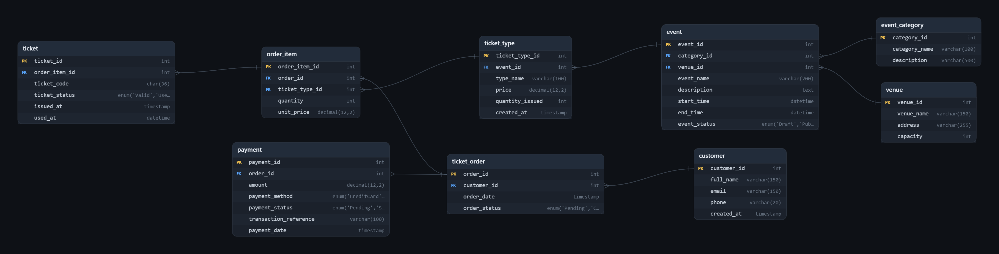

Thực hành Lab_01 - Môn Cơ Sở Dữ Liệu - Giảng viên Lê Hà Thanh

Họ tên: Nguyễn Thanh Tuyền - MSSV: N24DECE103


# Event Ticket Booking Database

## 1. Database Overview

The Event Ticket Booking database manages event information, venues, customers, ticket types, orders, payments, and issued tickets.

**Technologies:** MySQL, MySQL Workbench

## 2. Database Scripts

| File | Purpose |
|---|---|
| `create_database.sql` | Creates the `event_ticket_booking` database and selects it for use. |
| `create_table1.sql` | Creates `event_category`, `venue`, and `event`. |
| `create_table2.sql` | Creates `customer`, `ticket_type`, `ticket_order`, `order_item`, `payment`, and `ticket`. |
| `create_index.sql` | Creates indexes to support event, order, payment, and ticket queries. |
| `create_procedure.sql` | Creates the `get_order_summary` stored procedure. |
| `create_dulieu.sql` | Inserts sample data for database testing. |

### Execution Order

Execute the SQL scripts in MySQL Workbench in the following order:

1. `create_database.sql`
2. `create_table1.sql`
3. `create_table2.sql`
4. `create_index.sql`
5. `create_procedure.sql`
6. `create_dulieu.sql`

## 3. Entity Relationship Diagram (ERD)

The ERD illustrates the relationships among the nine database tables.



ERD created using [SQL to ER Diagram](https://sqltoerdiagram.com/).

### Relationships Between Tables

| Relationship | Type | Description |
|---|---|---|
| `event_category` – `event` | 1:N | One category can contain multiple events. Each event belongs to one category. |
| `venue` – `event` | 1:N | One venue can host multiple events. Each event takes place at one venue. |
| `event` – `ticket_type` | 1:N | One event can offer multiple ticket types. |
| `customer` – `ticket_order` | 1:N | One customer can create multiple orders. |
| `ticket_order` – `order_item` | 1:N | One order can contain multiple order items. |
| `ticket_type` – `order_item` | 1:N | One ticket type can appear in multiple order items. |
| `ticket_order` – `payment` | 1:N | One order can have multiple payment transactions. |
| `order_item` – `ticket` | 1:N | One order item can generate multiple individual tickets. |

**Note:** `customer` is associated with `payment` through `ticket_order`. There is no direct relationship between these two tables.

## 4. Table Documentation

### 4.1. `event_category`

Stores event categories, such as Music, Sports, Conference, and Festival.

| Column | Data Type | Constraints | Description |
|---|---|---|---|
| `category_id` | INT | PK, AUTO_INCREMENT | Category ID |
| `category_name` | VARCHAR(100) | NOT NULL, UNIQUE | Category name |
| `description` | VARCHAR(500) | NULL | Category description |

### 4.2. `venue`

Stores information about event venues, such as convention centers, stadiums, and theaters.

| Column | Data Type | Constraints | Description |
|---|---|---|---|
| `venue_id` | INT | PK, AUTO_INCREMENT | Venue ID |
| `venue_name` | VARCHAR(150) | NOT NULL | Venue name |
| `address` | VARCHAR(255) | NOT NULL | Venue address |
| `capacity` | INT | NOT NULL, CHECK > 0 | Venue capacity |

### 4.3. `event`

Stores event details, including its name, schedule, venue, category, and status.

| Column | Data Type | Constraints | Description |
|---|---|---|---|
| `event_id` | INT | PK, AUTO_INCREMENT | Event ID |
| `category_id` | INT | FK, NOT NULL | Event category |
| `venue_id` | INT | FK, NOT NULL | Event venue |
| `event_name` | VARCHAR(200) | NOT NULL | Event name |
| `description` | TEXT | NULL | Event description |
| `start_time` | DATETIME | NOT NULL | Event start time |
| `end_time` | DATETIME | NOT NULL, CHECK | Event end time |
| `event_status` | ENUM | NOT NULL, DEFAULT 'Draft' | Event status |

### 4.4. `customer`

Stores information about customers who purchase tickets.

| Column | Data Type | Constraints | Description |
|---|---|---|---|
| `customer_id` | INT | PK, AUTO_INCREMENT | Customer ID |
| `full_name` | VARCHAR(150) | NOT NULL | Full name |
| `email` | VARCHAR(150) | NOT NULL, UNIQUE | Email address |
| `phone` | VARCHAR(20) | NULL | Phone number |
| `created_at` | TIMESTAMP | NOT NULL, DEFAULT CURRENT_TIMESTAMP | Profile creation time |

### 4.5. `ticket_type`

Stores ticket types offered for each event, such as Standard and VIP.

| Column | Data Type | Constraints | Description |
|---|---|---|---|
| `ticket_type_id` | INT | PK, AUTO_INCREMENT | Ticket type ID |
| `event_id` | INT | FK, NOT NULL | Associated event |
| `type_name` | VARCHAR(100) | NOT NULL | Ticket type name |
| `price` | DECIMAL(12,2) | NOT NULL, CHECK >= 0 | Listed ticket price |
| `quantity_issued` | INT | NOT NULL, CHECK >= 0 | Planned ticket quantity |
| `created_at` | TIMESTAMP | NOT NULL, DEFAULT CURRENT_TIMESTAMP | Creation time |

**Unique constraint:** `(event_id, type_name)` ensures that ticket type names are unique within the same event.

### 4.6. `ticket_order`

Represents a ticket booking made by a customer.

| Column | Data Type | Constraints | Description |
|---|---|---|---|
| `order_id` | INT | PK, AUTO_INCREMENT | Order ID |
| `customer_id` | INT | FK, NOT NULL | Customer who placed the order |
| `order_date` | TIMESTAMP | NOT NULL, DEFAULT CURRENT_TIMESTAMP | Order date |
| `order_status` | ENUM | NOT NULL, DEFAULT 'Pending' | Order status |

### 4.7. `order_item`

Stores each ticket type purchased within an order.

| Column | Data Type | Constraints | Description |
|---|---|---|---|
| `order_item_id` | INT | PK, AUTO_INCREMENT | Order item ID |
| `order_id` | INT | FK, NOT NULL | Associated order |
| `ticket_type_id` | INT | FK, NOT NULL | Purchased ticket type |
| `quantity` | INT | NOT NULL, CHECK > 0 | Number of tickets |
| `unit_price` | DECIMAL(12,2) | NOT NULL, CHECK >= 0 | Price at purchase time |

The line total is calculated as:

`quantity * unit_price`

A separate line-total column is unnecessary because the value can be calculated.

### 4.8. `payment`

Stores payment transactions associated with orders.

| Column | Data Type | Constraints | Description |
|---|---|---|---|
| `payment_id` | INT | PK, AUTO_INCREMENT | Payment ID |
| `order_id` | INT | FK, NOT NULL | Associated order |
| `amount` | DECIMAL(12,2) | NOT NULL, CHECK >= 0 | Transaction amount |
| `payment_method` | ENUM | NOT NULL | Payment method |
| `payment_status` | ENUM | NOT NULL, DEFAULT 'Pending' | Payment status |
| `transaction_reference` | VARCHAR(100) | UNIQUE, NULL | Payment gateway reference |
| `payment_date` | TIMESTAMP | NOT NULL, DEFAULT CURRENT_TIMESTAMP | Transaction recording time |

### 4.9. `ticket`

Stores individual tickets issued from order items.

| Column | Data Type | Constraints | Description |
|---|---|---|---|
| `ticket_id` | INT | PK, AUTO_INCREMENT | Ticket record ID |
| `order_item_id` | INT | FK, NOT NULL | Associated order item |
| `ticket_code` | CHAR(36) | NOT NULL, UNIQUE | Ticket authentication code |
| `ticket_status` | ENUM | NOT NULL, DEFAULT 'Valid' | Ticket status |
| `issued_at` | TIMESTAMP | NOT NULL, DEFAULT CURRENT_TIMESTAMP | Ticket issuance time |
| `used_at` | DATETIME | NULL | Ticket usage time |

## 5. Index Documentation

Indexes improve query performance when searching events, orders, payments, and tickets.

| Index Name | Table | Columns | Type | Purpose |
|---|---|---|---|---|
| `PRIMARY` | `event` | `event_id` | Unique B-tree | Identifies each event |
| `uq_customer_email` | `customer` | `email` | Unique B-tree | Prevents duplicate customer emails |
| `uq_ticket_code` | `ticket` | `ticket_code` | Unique B-tree | Supports ticket lookup and authentication |
| `idx_event_start_time` | `event` | `start_time` | Non-unique B-tree | Filters and sorts events by start time |
| `idx_event_status_start_time` | `event` | `event_status`, `start_time` | Non-unique B-tree | Filters by status and then start time |
| `idx_ticket_order_customer_date` | `ticket_order` | `customer_id`, `order_date` | Non-unique B-tree | Retrieves customer orders by date |
| `idx_payment_order_status` | `payment` | `order_id`, `payment_status` | Non-unique B-tree | Retrieves payment statuses for an order |
| `idx_ticket_order_item` | `ticket` | `order_item_id` | Non-unique B-tree | Retrieves tickets belonging to an order item |

## 6. Constraints Documentation

### 6.1. Primary Key Constraints

Primary keys uniquely identify records in each table.

| Constraint | Table | Column | Purpose |
|---|---|---|---|
| `pk_event_category` | `event_category` | `category_id` | Identifies each category |
| `pk_venue` | `venue` | `venue_id` | Identifies each venue |
| `pk_event` | `event` | `event_id` | Identifies each event |
| `pk_customer` | `customer` | `customer_id` | Identifies each customer |
| `pk_ticket_type` | `ticket_type` | `ticket_type_id` | Identifies each ticket type |
| `pk_ticket_order` | `ticket_order` | `order_id` | Identifies each order |
| `pk_order_item` | `order_item` | `order_item_id` | Identifies each order item |
| `pk_payment` | `payment` | `payment_id` | Identifies each payment |
| `pk_ticket` | `ticket` | `ticket_id` | Identifies each ticket |

### 6.2. Foreign Key Constraints

Foreign keys maintain referential integrity between related tables.

| Constraint | Table.Column | References | Purpose |
|---|---|---|---|
| `fk_event_category` | `event.category_id` | `event_category.category_id` | Links an event to its category |
| `fk_event_venue` | `event.venue_id` | `venue.venue_id` | Links an event to its venue |
| `fk_ticket_type_event` | `ticket_type.event_id` | `event.event_id` | Associates a ticket type with an event |
| `fk_ticket_order_customer` | `ticket_order.customer_id` | `customer.customer_id` | Identifies the customer placing an order |
| `fk_order_item_order` | `order_item.order_id` | `ticket_order.order_id` | Links an order item to its order |
| `fk_order_item_ticket_type` | `order_item.ticket_type_id` | `ticket_type.ticket_type_id` | Identifies the purchased ticket type |
| `fk_payment_order` | `payment.order_id` | `ticket_order.order_id` | Links a payment to its order |
| `fk_ticket_order_item` | `ticket.order_item_id` | `order_item.order_item_id` | Links an issued ticket to its order item |

Foreign keys use the default `RESTRICT` / `NO ACTION` behavior for deleting or updating referenced records. This helps prevent accidental deletion of orders, payments, and tickets.

### 6.3. Unique Constraints

Unique constraints prevent duplicate values where uniqueness is required.

| Constraint | Table | Column(s) | Purpose |
|---|---|---|---|
| `uq_event_category_name` | `event_category` | `category_name` | Prevents duplicate category names |
| `uq_customer_email` | `customer` | `email` | Prevents duplicate email addresses |
| `uq_ticket_type_event_name` | `ticket_type` | `event_id`, `type_name` | Prevents duplicate ticket type names within an event |
| `uq_order_item_order_type` | `order_item` | `order_id`, `ticket_type_id` | Allows only one row per ticket type in each order |
| `uq_payment_transaction_reference` | `payment` | `transaction_reference` | Prevents duplicate transaction references when provided |
| `uq_ticket_code` | `ticket` | `ticket_code` | Prevents duplicate ticket codes |

### 6.4. Check Constraints

Check constraints validate values before they are stored.

| Constraint | Table | Rule | Purpose |
|---|---|---|---|
| `chk_venue_capacity` | `venue` | `capacity > 0` | Venue capacity must be positive |
| `chk_event_time` | `event` | `end_time > start_time` | Event end time must follow start time |
| `chk_ticket_price` | `ticket_type` | `price >= 0` | Ticket price cannot be negative |
| `chk_ticket_quantity` | `ticket_type` | `quantity_issued >= 0` | Issued quantity cannot be negative |
| `chk_order_item_quantity` | `order_item` | `quantity > 0` | Order quantity must be positive |
| `chk_order_item_price` | `order_item` | `unit_price >= 0` | Purchase price cannot be negative |
| `chk_payment_amount` | `payment` | `amount >= 0` | Payment amount cannot be negative |

## 7. Stored Procedure Documentation

### `get_order_summary`

**Purpose:** Retrieves order information and calculates the total number of tickets and the total order value.

**Input parameter**

| Parameter | Data Type | Description |
|---|---|---|
| `p_order_id` | INT | ID of the order to retrieve |

**Returned fields**

| Field | Description |
|---|---|
| `order_id` | Order ID |
| `customer_name` | Customer name |
| `order_date` | Order date |
| `order_status` | Order status |
| `total_tickets` | Total number of tickets |
| `order_total` | Total order value |

**Tables involved**

- `ticket_order`
- `customer`
- `order_item`

**Description**

The procedure retrieves the order identified by the supplied order ID, joins the `customer` table to obtain the customer's name, and uses `order_item` to calculate the total ticket quantity and order value.

The `COALESCE` function returns `0` when an order has no order items.

**Testing**

Run the following statement in MySQL Workbench to retrieve the summary for order ID `1`:

```sql
CALL get_order_summary(1);
```

## 8. Version Control

The SQL scripts and Database Design Documentation (DDD) are managed using Git.

When database tables, columns, indexes, constraints, or stored procedures change, the related files should be updated and committed. This makes it possible to review change history and restore earlier versions when necessary.

**GitHub Repository:** [Event Ticket Booking](https://github.com/Thtuyen99/Event_ticket_booking)

## 9. Regular Updates

The Database Design Documentation must be updated whenever the database structure changes, including:

- Adding, modifying, or deleting tables and columns.
- Adding, modifying, or deleting indexes.
- Changing primary keys, foreign keys, unique constraints, or check constraints.
- Modifying stored procedures.

After each change, compare the DDD with the SQL scripts to ensure the documentation accurately reflects the current database structure.

